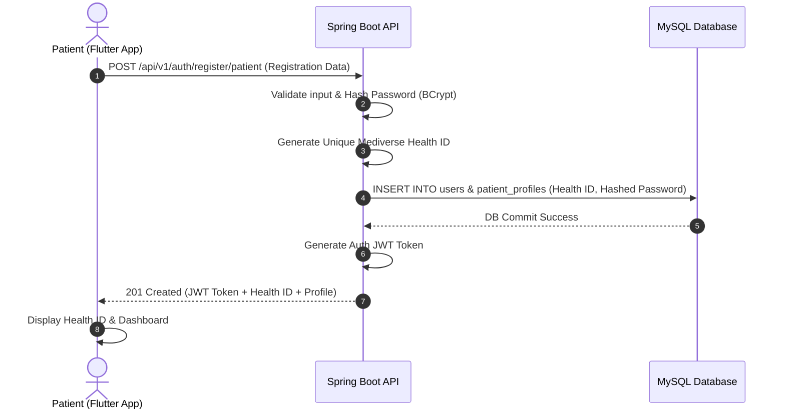
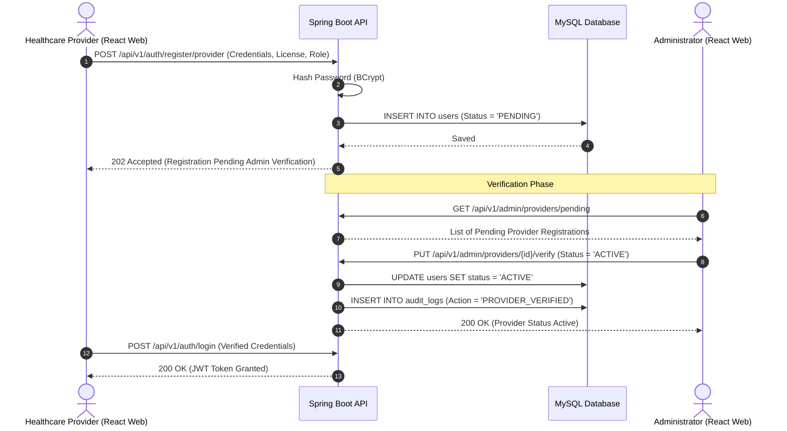
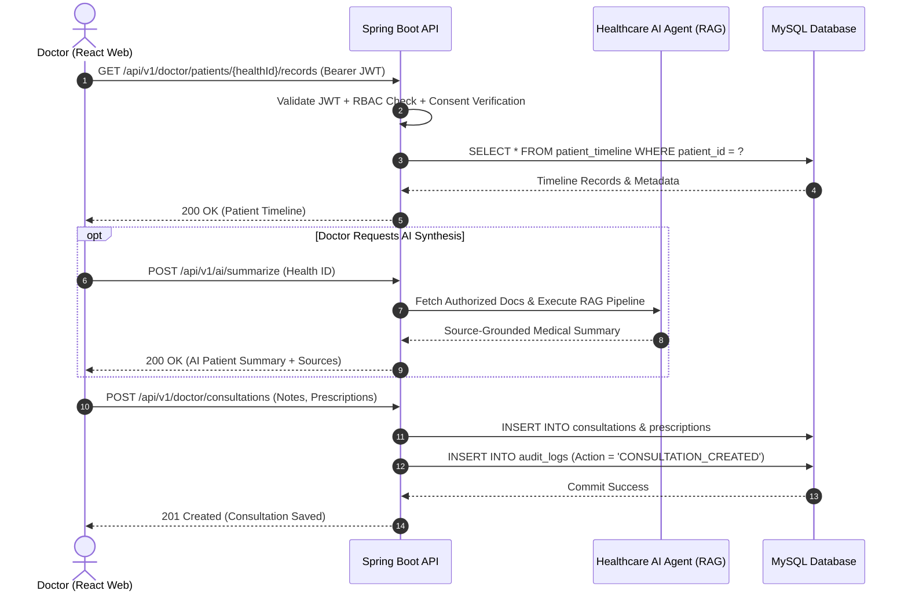
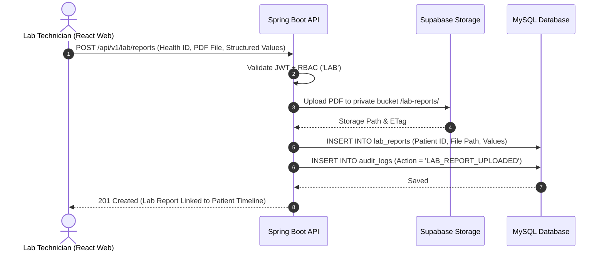
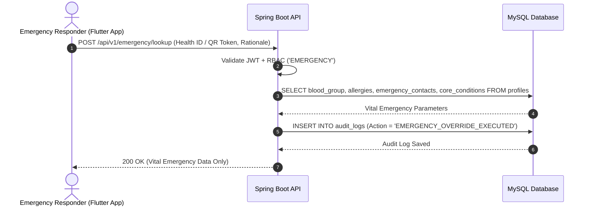
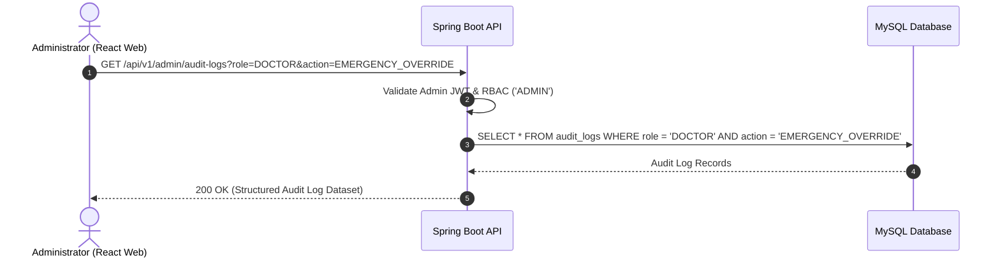

# 08 — USER WORKFLOWS

## 8.1 WORKFLOW OVERVIEW

This document specifies the primary operational workflows across all six Mediverse roles. Each workflow is detailed with step-by-step descriptions and corresponding **Mermaid sequence diagrams**.

---

## 8.2 PATIENT REGISTRATION WORKFLOW

### Step-by-Step Description
1. Patient opens the Flutter Mobile App and selects **Register**.
2. Patient submits demographic details (Name, Email, Phone, Password, DOB, Gender).
3. Mobile App sends `POST /api/v1/auth/register/patient` request to Spring Boot API.
4. Backend validates inputs, hashes password using BCrypt, and creates a `User` entity.
5. Backend invokes the **Health ID Generator Service** to produce a unique, persistent `Mediverse Health ID`.
6. Backend persists Patient Profile and Health ID record in MySQL within a `@Transactional` boundary.
7. Backend generates a JWT token and returns registration success + Health ID + token to mobile app.
8. Patient logs in and views their newly assigned Health ID on their profile dashboard.

---

## 8.3 HEALTHCARE PROVIDER REGISTRATION WORKFLOW (DOCTOR / MEDICAL / LAB)

### Step-by-Step Description
1. Provider opens the React Web Portal and fills out the Provider Registration Form.
2. Provider selects Role (`DOCTOR`, `MEDICAL`, or `LAB`), enters license/registration credentials, email, and password.
3. Web App sends `POST /api/v1/auth/register/provider` to Spring Boot API.
4. Backend creates user record with verification status set to `PENDING`.
5. Provider is informed that account is pending Admin review and cannot access clinical features yet.
6. Admin logs into Admin Web Portal and views the **Provider Verification Queue**.
7. Admin inspects license credentials and clicks **Approve** or **Reject**.
8. Backend updates provider status to `ACTIVE` (or `REJECTED`) in MySQL and logs audit entry.
9. Verified Provider logs in successfully and accesses full portal capabilities.

---

## 8.4 DOCTOR CONSULTATION & PATIENT RECORD ACCESS WORKFLOW

### Step-by-Step Description
1. Doctor logs into the Doctor Web Portal (`ACTIVE` status confirmed via JWT).
2. Doctor identifies patient by entering Health ID or scanning secure QR reference.
3. Doctor Web App calls `GET /api/v1/doctor/patients/{healthId}/records`.
4. Backend validates Doctor JWT, verifies RBAC role (`DOCTOR`), checks patient consent.
5. Backend fetches authorized patient timeline, lab reports, and prescriptions from MySQL.
6. Doctor reviews timeline and optionally requests AI summary via `POST /api/v1/ai/summarize`.
7. Mediverse Healthcare Record Agent retrieves source documents, runs RAG, and generates grounded summary.
8. Doctor conducts consultation, enters clinical notes and digital prescription, and submits form.
9. Backend saves consultation and prescription to MySQL, links to timeline, and creates audit log.

---

## 8.5 DIAGNOSTIC LABORATORY WORKFLOW

### Step-by-Step Description
1. Lab user logs into Lab Web Portal.
2. Lab identifies patient using Mediverse Health ID.
3. Lab creates a new diagnostic test record (e.g., Lipid Profile Test).
4. Lab technician inputs structured test metrics and uploads diagnostic PDF report.
5. Web App calls `POST /api/v1/lab/reports` with multipart file payload.
6. Backend uploads PDF file directly to private bucket in Supabase Storage.
7. Backend inserts metadata (file path, test values, lab ID, patient ID) into MySQL.
8. Backend attaches lab report entry to patient timeline and logs audit entry.

---

## 8.6 MEDICAL ORGANIZATION HOSPITAL ADMISSION WORKFLOW

### Step-by-Step Description
1. Hospital staff log into Medical Web Portal.
2. Staff look up patient via Health ID for hospital admission.
3. Staff enter admission details (department, ward, admitting doctor, diagnosis).
4. API persists admission record to MySQL and links encounter to patient timeline.
5. During stay, hospital uploads treatment reports / surgical summaries to Supabase Storage.
6. Upon discharge, hospital composes official discharge summary and clicks **Publish**.
7. Backend locks discharge record, links file reference to timeline, and creates audit log.

---

## 8.7 EMERGENCY ACCESS OVERRIDE WORKFLOW

### Step-by-Step Description
1. First responder opens Emergency Flutter App and enters emergency mode.
2. Responder scans patient emergency QR code or enters Health ID under emergency override.
3. App calls `POST /api/v1/emergency/lookup` with emergency trigger rationale.
4. Backend validates Emergency user JWT and executes Emergency Access Handler.
5. Backend retrieves strictly vital parameters (blood group, allergies, emergency contacts, core conditions).
6. Backend bypasses standard non-emergency consent checks BUT immediately writes an immutable emergency audit record.
7. Mobile app displays emergency triage parameters to responder.

---

## 8.8 ADMINISTRATIVE VERIFICATION & SYSTEM AUDIT WORKFLOW

### Step-by-Step Description
1. Administrator logs into Admin Web Portal.
2. Admin reviews pending provider applications in the verification dashboard.
3. Admin approves/rejects registrations and activates/deactivates user accounts.
4. Admin opens Security Audit Monitoring tab and sets filter criteria (Date range, Role, Action).
5. App calls `GET /api/v1/admin/audit-logs`.
6. Backend returns audit log records; Admin inspects system security activity.

